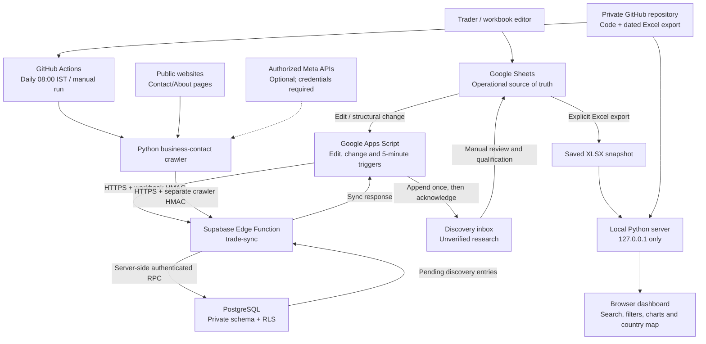
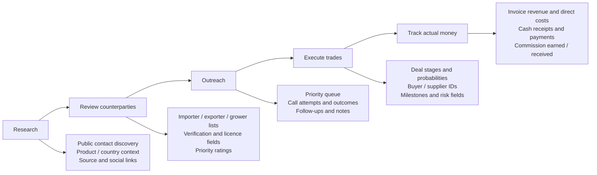
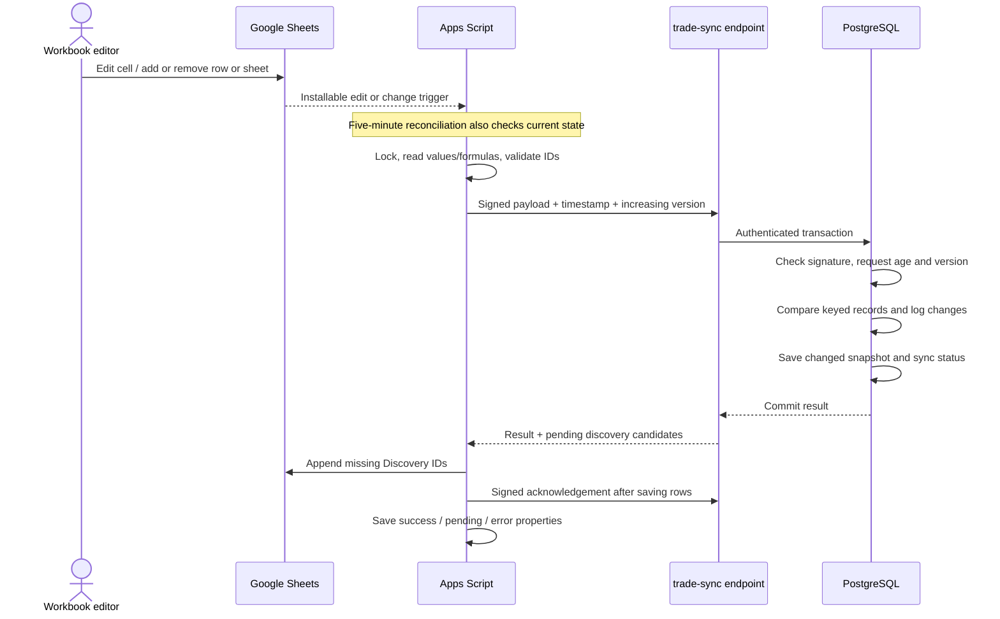
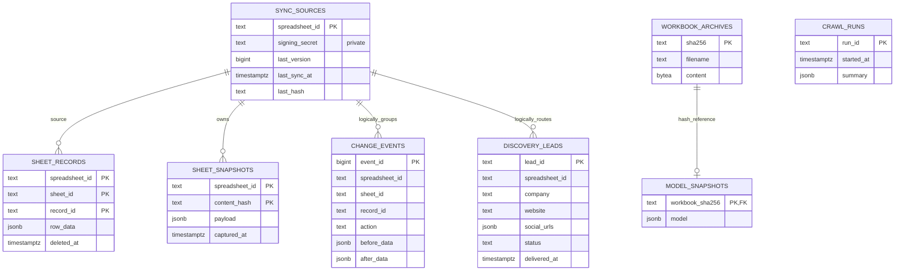
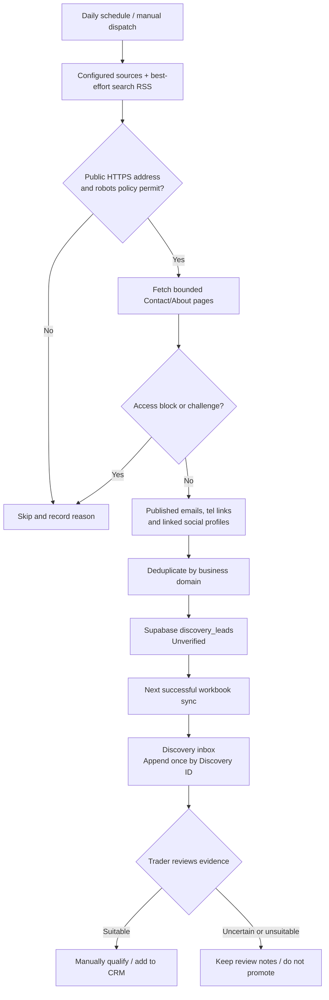
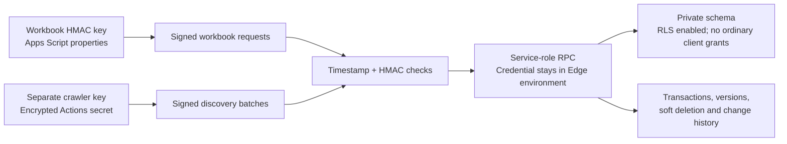
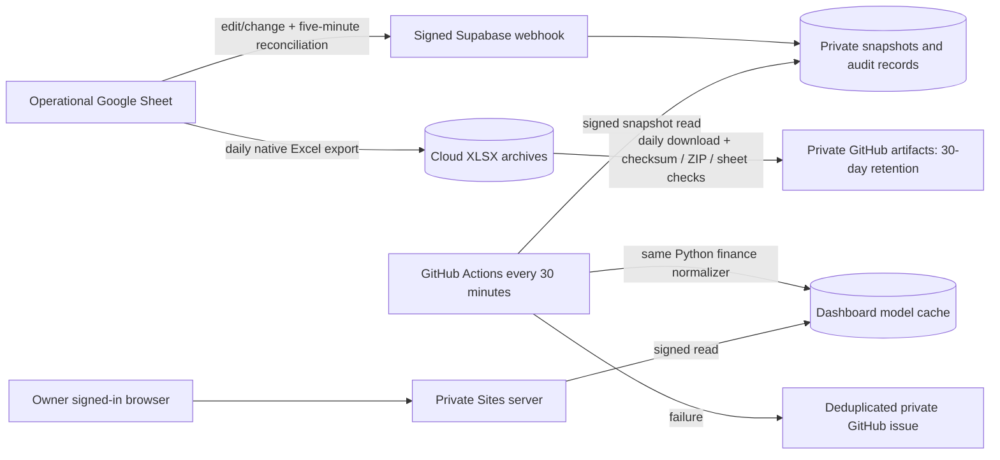

# Global Trade Intelligence

Private import/export operating workbook, trading dashboard, Google Sheets synchronization, Supabase audit storage and scheduled public-business discovery.

This application helps a trader research counterparties, prioritize outreach, track calls and deals, and reconcile commercial activity with recorded financial results. It combines an operational spreadsheet, a local browser dashboard, and a cloud synchronization/discovery pipeline. It is a custom application and spreadsheet system, not a native Power BI report.

## Architecture



**Important boundaries:** Google Sheets is the operational source. General record synchronization runs from Sheets to Supabase. The reverse path only delivers research candidates to the Discovery inbox; it is not general database-to-CRM writeback. The local web dashboard reads a saved XLSX file. GitHub contains code and a dated Excel export, not a continuously updated copy of the database.

## Feature map



| Feature | How it works |
|---|---|
| Executive dashboard | Network totals, pipeline measures, selected monthly trends, product/country summaries and opportunity details. Missing histories are identified instead of fabricated. |
| Business network | Importer, exporter and grower/supplier records with stable Contact IDs, published contact channels, source evidence, verification fields and manual ratings. |
| Sales operations | Configurable priority scoring, recorded call attempts/connections, qualification, next actions and follow-up dates. |
| Trade execution | Deals linked through IDs, direction, quantity/unit, stage, probability, amounts, commission inputs and milestones. |
| Financial analysis | Estimated pipeline, invoice revenue, direct trade contribution, customer cash collections, commissions, credits and refunds are separate concepts. |
| Local web interface | Search, filters, metric selection, sortable tables, company/deal drawers and country-level geographic exploration. |
| Cloud persistence | Keyed operational records, before/after audit events, recoverable soft deletions and deduplicated values/formulas snapshots. |
| Automated discovery | Bounded public-web research, domain deduplication, provenance, unverified leads and idempotent delivery to the workbook. |

## Workbook structure

| Worksheet | Purpose |
|---|---|
| Dashboard | Operating overview, KPI cards, selectors and charts. |
| Discovery inbox | Website-derived candidates for review; no automatic verification or CRM promotion. |
| Priority queue | Calling and follow-up priorities based on entered ratings and rules. |
| Settings | Scoring weights, reporting year and operating assumptions. |
| Importers | Buyer/importer directory and relationship assessments. |
| Exporters | Exporter directory and assessments. |
| Growers and suppliers | Producer/supplier directory and assessments. |
| Market watch | Entered product-market observations and freshness checks. |
| Call log | Attempted contacts, outcomes, qualification and next actions. |
| Deals | Commercial opportunities, values, supplier/buyer keys and commission details. |
| Milestones | Execution dates, outstanding actions and delays. |
| Guide | Operating instructions, definitions and data gaps. |
| Cash ledger | Actual cash receipts, payments and refund categories. |
| Monthly finance | Monthly invoice, direct contribution and cash summaries/charts. |

## How a workbook edit becomes a database update



Operational rows are identified by **spreadsheet ID + sheet ID + record ID**. The current source tables use row 5 for headers and column A for stable IDs. Reordering rows does not change identity. Changing an ID is treated as removal of the old identity and insertion of the new one.

- Duplicate IDs reject the sync instead of silently merging records.
- Rows without IDs remain in snapshots, but do not become individual keyed records.
- Deleted records retain their old values and audit history. A reappearing ID restores the record.
- Identical content does not create another snapshot; stale versions cannot overwrite newer state.
- A failed transaction preserves the last successfully committed database state.
- Script/API writes are caught by reconciliation rather than ordinary edit triggers. Rapid intermediate changes may be represented only by their final reconciled state.

## Database model



Tables are in `trade_private`. Relationships labelled “logically” are routing/audit associations, not enforced foreign keys. `workbook_archives` and `model_snapshots` are provisioned archival tables. Regular synchronization uses `sheet_snapshots`; it does not automatically upload XLSX binaries to the archival tables.

## Discovery lifecycle



Discovery entries can overlap the main directory. They are research evidence, not a guarantee of new companies. Country/product/role values can come from configured seed metadata or page-based classification and require review. Crawler claims never overwrite main CRM records.

## Security and failure handling



The crawler key authorizes discovery ingestion, not ordinary workbook record updates. Secrets are excluded from Git. No public database read API is deployed. Source pages and extracted fields are untrusted input; the inbox importer escapes spreadsheet formula prefixes before writing cells. Sync errors are stored in Apps Script properties; crawler errors are visible in Actions run summaries.

## Deployment and maintenance

| Component | Location | Update procedure |
|---|---|---|
| Operational workbook | Google Sheets | Edit existing tables and preserve stable IDs. |
| Trigger code | Saved Apps Script project | Update `backend/Code.gs` in the editor and save; installed triggers use saved source. Run `tradeSyncNow` for manual reconciliation. |
| Cloud endpoint | Supabase `trade-sync` | Deploy `backend/ingest.ts`; preserve the signed-authentication boundary. |
| Database | Supabase PostgreSQL | New installs apply `bootstrap.sql`, then `schema.sql`, then `discovery.sql`, and provision private source/signing configuration separately. These are initial migrations, not an idempotent reset script. |
| Crawler | GitHub Actions | Edit `crawler/config.json` / `crawler/run.py`, push to the default branch, and use Actions → Daily trade contact discovery → Run workflow. |
| Excel copy | `data/Trade_Business_Dashboard.xlsx` | Explicitly export the latest Google Sheet and replace the dated snapshot. |
| Local dashboard | Local Python process | Restart the server after Python changes; reload the browser for static JavaScript/CSS changes. |

Monitor **Apps Script → Executions** and the `TRADE_LAST_SYNC`, `TRADE_LAST_ERROR`, `TRADE_PENDING` properties. Database source status is in `sync_sources`. Monitor scheduled research in the [Actions page](https://github.com/Gayatri2502/global-trade-intelligence/actions). A successful cron dispatch alone is not proof of delivery; verify the run result and inbox acknowledgement.

### Tests

```sh
python3 -m unittest discover -s crawler -p 'test_*.py'
node outputs/global_trade_intelligence/test_metrics.mjs
python3 outputs/global_trade_intelligence/test_workbook_data.py
```

Tests cover contact extraction, domain deduplication, challenge-page rejection, avoiding guessed phone numbers, financial calculations, refunds, missing FX and filtering without multiplying deal values. Synthetic fixtures are isolated from business records. Database insert/update/soft-delete/restore checks were run inside a rolled-back transaction. The initial live sync and a completed GitHub crawler run were separately verified.

### Recovery and limitations

Snapshots retain values and formulas, not full formatting, charts or sharing permissions. Soft-deleted rows can be recovered from stored record/history data by an administrator; no one-click restore interface is implemented. Keep independent Excel exports and test restorations. Cloud storage, GitHub and the free-tier schedule do not guarantee zero data loss or uninterrupted service.

The source sync has a 350,000-cell safety limit. Discovery limits are 30 domains, three pages per domain, a seven-minute crawl budget and a ten-minute Actions job timeout. The importer receives at most 100 pending candidates per successful sync. Expanding these limits requires reviewing quota, payload and runtime behavior.

## Live workbook

https://docs.google.com/spreadsheets/d/1wNPYCBBXAn3y2uJ4LOV6vGgWzYhro_PPGk2HsU0cjj0/edit

Google Sheets is the operational source of truth. The `data/Trade_Business_Dashboard.xlsx` file is a dated export, not a live connection to Google Sheets. Export the Sheet again when you need an updated Excel file. Existing formulas, contact IDs, call tracking, deals and financial schedules remain in the workbook.

## Run locally

Python 3.12+ is sufficient; the application and crawler use the standard library.

```sh
python3 outputs/global_trade_intelligence/server.py --open
python3 -m unittest discover -s crawler -p 'test_*.py'
python3 crawler/run.py --dry-run
```

The local dashboard binds only to `127.0.0.1:8765`. It reads the saved Excel file; it does not expose the database or a public website. For an explicit workbook use the `TRADE_WORKBOOK` environment variable. Preserve the folder structure when cloning.

## Cloud synchronization

The authorized Apps Script in `backend/Code.gs` sends signed updates to the deployed Supabase `trade-sync` endpoint. The database stores source records, changes and values/formulas snapshots. Deletions are recoverable soft deletions. Read `backend/README.md` for synchronization limits and recovery details. Secrets belong in Script Properties, private database configuration or encrypted GitHub Actions secrets, never committed files.

## Scheduled discovery

GitHub Actions runs `crawler/run.py` daily at **08:00 Asia/Kolkata** (02:30 UTC) and can be run manually from Actions. The job has a ten-minute timeout, at most 30 domains and three pages per domain. It checks robots.txt, refuses non-public network addresses, pauses between requests, stops on access blocks, and stores provenance and an Unverified status. A separate crawler signing key can only ingest discovery leads; it cannot overwrite workbook records.

The crawler starts from the reviewed sources in `crawler/config.json`, follows same-domain Contact/About links and tries three public search RSS queries. Search results are best effort and may be unavailable. It extracts published business email and explicit telephone links; it does not guess phone numbers from quantities or identifiers. Deduplication is by business domain, so separate branches on one domain are intentionally combined pending human review.

Discovered leads go to the private `discovery_leads` table, then the workbook's **Discovery inbox** on the next successful Apps Script sync (normally within five minutes). They are not automatically promoted to verified Importers/Exporters. The inbox is idempotent by Discovery ID. Acknowledgements are sent only after rows are saved.

## Social-platform status

Public website links to social profiles are saved as evidence. **Direct Instagram/Facebook API collection is not active without your authorized Meta API credentials and allowed targets.** Add a Meta token as the `META_ACCESS_TOKEN` repository secret, an applicable supported Graph version as `META_GRAPH_VERSION`, and permitted page IDs/usernames in the config. Instagram Business Discovery also needs `META_IG_BUSINESS_ID`. The integration uses official Graph requests and does not attempt login bypass, private groups, protected profiles or anti-bot circumvention. It cannot crawl every social-media account.

## Cost and data quality

The database project was quoted at $0/month. GitHub Actions uses the account's included private-repository allowance; no paid crawler API or trial is enabled. Daily runs are bounded, but platform quotas and availability still apply. Keep spending limits at zero in your account if you require a hard no-charge policy.

Source pages may contain obsolete or incorrect claims. Review identities, contact channels, certifications and commercial suitability before outreach. Published licence claims are not independently verified. No synthetic business transactions are included.

## Repository contents

- `data/`: live-workbook export captured when this repository was prepared.
- `outputs/global_trade_intelligence/`: local dashboard and XLSX reader.
- `backend/`: versioned SQL, deployed Edge Function source and Apps Script source.
- `crawler/`: public web discovery, authorized social API adapters, configuration and tests.
- `.github/workflows/discovery.yml`: daily cron and manual execution.

This repository is private and contains business data. Do not make it public without reviewing and removing that data. It is not an independent guarantee against data loss; retain separate exports and restore-tested backups.

## Hosted dashboard, automated model refresh and recovery

The owner-private dashboard is hosted at https://global-trade-intelligence-desk.samalg2502.chatgpt.site. Sites provides sign-in and the private access boundary; sharing has not been widened. Server-side HMAC credentials are stored as runtime secrets, never in browser JavaScript.



- Edit the existing Google Sheet as usual. Database reconciliation runs every five minutes; the hosted model refresh is scheduled every 30 minutes, subject to GitHub scheduling delays. The open browser checks for the latest model every minute. It is not instantaneous streaming.
- `operations/run.py` uses the existing tested Python normalizer, keeping invoices, collected cash, commissions, refunds and missing FX distinct. It rejects stale source synchronization rather than silently replacing the model.
- `backend/Code.gs` includes `installTradeBackups`, which installs one daily trigger and performs a native Sheets-to-XLSX export immediately. Native export preserves charts, formatting and formulas. The server stores immutable archives keyed by SHA-256.
- The operations workflow checks native backups during the 04:00 UTC hour daily, and on manual dispatch with `backup=true`. It checks SHA-256, ZIP integrity and required workbook sheets before retaining the XLSX plus raw snapshot and verification manifest as private artifacts for 30 days.
- Recovery: download a verified artifact from the Actions run, inspect its manifest, open the XLSX in Excel, and import into a **new** Google spreadsheet for review before replacing any live source. Automatic restoration into the production workbook is deliberately not performed. Structural recovery checks do not constitute a full disaster-recovery drill of triggers, permissions and cloud infrastructure.
- Workflow failures create one private issue named `Trade operations need attention`; GitHub notification preferences determine whether you receive email. Check Actions and that issue after changing credentials or permissions.
- No service can guarantee zero loss. GitHub artifact expiration, free-tier quotas, account access and delayed jobs remain practical limits. Keep occasional offline copies for longer retention.

### Rebuild and test

```sh
python3 operations/test_snapshot.py
python3 outputs/global_trade_intelligence/test_workbook_data.py
node --test outputs/global_trade_intelligence/test_metrics.mjs
python3 hosted/scripts/embed.py
bash hosted/scripts/build.sh
node hosted/scripts/validate-artifact.mjs
```

`TRADE_OPERATIONS_SECRET` is required in encrypted GitHub Actions secrets and private Sites runtime variables. `backend/operations.sql` adds the strictly signed operations RPC. The workbook signing key remains separate from the operations key. A fresh installation must register both keys securely; no keys are committed.

Facebook/Instagram account authorization remains the final integration step. The bounded public-web discovery job remains usable without it; social profile links do not mean their private content has been crawled. Enable authorized Meta API credentials only for accounts/data the API permits.

Latest end-to-end verification: the manually dispatched [operations run](https://github.com/Gayatri2502/global-trade-intelligence/actions/runs/40701514748) successfully refreshed the model and retained a validated native Excel backup artifact. This confirms cloud execution and independent artifact storage; full production restore remains a separate manual review step.
